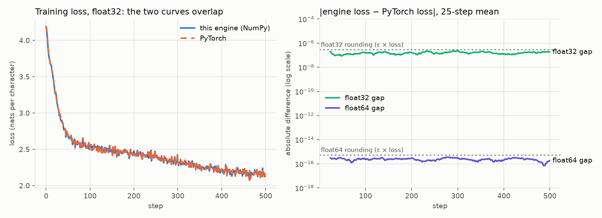

# Report

Each section asks one question, describes the setup and gives the measured answer and its limits. Every number regenerates from a clean checkout with the command shown. Runs write their raw numbers to `results/`, which is gitignored; the figures are committed in `docs/figures/`.

Hardware for every run: a 4-core, 8-thread laptop CPU with 13.9 GB of RAM and no GPU.

---

## 1. Does training on this engine follow PyTorch, and how much slower is it?

`python -m experiments.engine_vs_torch` (needs the `[dev]` extra for torch; about 35 minutes)

**Setup.** Both engines train the baseline GPT for 500 steps:
- **Model:** 4 layers, 4 heads, width 128, a 128-character context, 0.82M parameters.
- **Same everything:** identical initial weights and the same TinyShakespeare batches in the same order (16 × 128 characters each).
- **Same recipe as `scratchgpt.train`:** AdamW with betas (0.9, 0.99) and weight decay 0.1 on matrices only; a 100-step warmup to lr 2e-3 with cosine decay to 2e-4; gradient clipping at 1.0.
- **Threads:** 4 BLAS threads for NumPy and 4 for PyTorch.
- **Implementations:** the PyTorch side uses torch's own layer norm, `scaled_dot_product_attention`, GELU and cross-entropy (`experiments/torch_gpt.py`), not a translation of this engine.
- **Control:** the whole comparison is repeated in float64.

| | float32 | float64 (control) |
|---|---|---|
| Largest loss gap in 500 steps | 7.2 × 10⁻⁷ | 1.3 × 10⁻¹⁵ |
| Mean gap, steps 0–99 | 1.5 × 10⁻⁷ | 2.5 × 10⁻¹⁶ |
| Mean gap, steps 400–499 | 1.6 × 10⁻⁷ | 2.3 × 10⁻¹⁶ |
| Steps where the two losses are bitwise equal | 42% | 50% |
| Loss at step 500, engine / PyTorch | 2.1289 / 2.1289 | 2.1289 / 2.1289 |
| Largest weight difference after 500 steps | 1.5 × 10⁻³ | 3.3 × 10⁻¹² |
| Median time per step, engine / PyTorch | 1131 / 319 ms | 1370 / 643 ms |
| Engine slowdown | 3.5× | 2.1× |

**Answer.**
- **The engine follows PyTorch to rounding error, and the error does not grow.** In float32 the loss gap stays around 1.5 × 10⁻⁷ from the first 100 steps to the last. That's just below float32's rounding size at this loss (ε × median loss ≈ 2.9 × 10⁻⁷).
- **The control confirms it's rounding.** In float64 the same comparison agrees to about 10⁻¹⁶, which is float64's rounding size (ε × median loss ≈ 5.3 × 10⁻¹⁶). If the two engines computed different maths, the gap would not shrink by nine orders of magnitude when the precision goes up.
- **It's 2 to 4 times slower than PyTorch on this CPU**, which is less than I expected from a pure-NumPy engine. The saved run measured 3.5× in float32. An earlier, interrupted run measured 993 against 428 ms per step (2.3×). Most of the engine's time goes to the same BLAS matrix products PyTorch uses. The rest is element-wise NumPy work that PyTorch fuses or runs in tighter kernels.

**One thing the loss hides.** The weights drift apart by up to 1.5 × 10⁻³, about 10,000 times the loss gap, while the loss curves stay identical. My explanation, not yet tested: Adam divides each update by the gradient's running size. Where a gradient component is near zero, rounding can flip its sign, and that weight then moves a full step (up to the learning rate, 2 × 10⁻³) in the other direction. Such weights barely affect the loss, which is why the curves don't separate. Testing it would mean saving per-step weight gaps and checking that the largest ones sit on near-zero gradients.

**Limits.**
- One seed, one machine and 500 steps.
- Times vary by about 30% between runs because the laptop runs other software. PyTorch's float32 time ranged from 319 to 428 ms between the two runs.
- My engine always ran before PyTorch, so any thermal throttling would count against mine.
- The engine's gradient clipping computes the norm in float64, while PyTorch uses float32. That's a tiny extra difference, and part of what the float32 gap measures.
